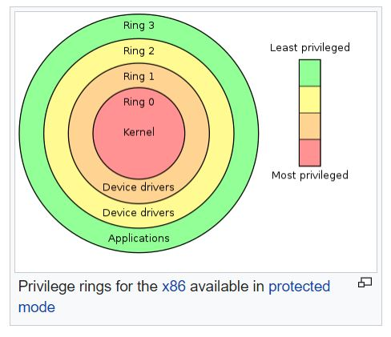

# KFS-2
Kernel From Scratch

## Goals
You will have to **create**, **fill** and **link** a Global Descriptor Table into your Kernel.
Actually, you will have to understand how "memory" really works in a system, how the **Stack** and **RAM** works, how to use it, how to fill it and how to link it with the **BIOS**.
Yeah, the BIOS. Thanks to **GRUB** (Bootloader), it will help you a lot !

## Mandatory
### Base
Let’s sum this up:
	• You must create a [[GDT (Global Descriptor Table)]].
	• Your GDT must contain:
		◦ Kernel Code
		◦ Kernel Data
		◦ Kernel stack
		◦ User code
		◦ User data
		◦ User stack
		◦ Your work should not exceed 10 MB.
	• You must declare your GDT to the BIOS.
	• The GDT must be set at address 0x00000800.
When this is done, you have to code a tool to print the kernel stack, in a human-friendly
way. (Tip: If you haven’t made a printk yet, now is a good time !)

### Makefile
Your makefile must compile all your source files with the right flags and the right compiler. Keep in mind that your kernel will use at least two different languages (ASM and whatever-you-choose), so make your Makefile’s rules correctly.
After compilation, all the objects must be linked together in order to create the final [[Kernel (operating system)|Kernel binary]] (Cf. [[Linker (ld)|Linker part]]).

## Bonus
Assuming your keyboard work correctly in your Kernel, and you able to catch an entry, let’s code a Shell !
Not a POSIX Shell, just a minimalistic shell with a few commands, for debugging purposes.
For example, you could implement the print-kernel-stack-thing in this shell, and some other things like reboot, halt and such.

## Walkthrough
From what we did in KFS-1, we will need to implement the GDT table.
But first, what is the GDT and what does it do? 
GDT or Global Descriptor Table is the implementation of the segmentation in protected mode. It is a table that contains entries that describe the memory segments of the system. Each entry contains information about the base address, limit, and access rights of a segment. The GDT is used by the CPU to translate logical addresses to physical addresses and to enforce memory protection.
Not to be confused with paging, which is another memory management technique that allows the system to use more memory than the physical RAM by using a portion of the hard drive as virtual memory.
The main difference between segmentation and paging is that segmentation divides the memory into variable-sized segments, while paging divides the memory into fixed-size pages. Segmentation is more flexible but can lead to fragmentation, while paging is more efficient but can lead to overhead due to page tables.
From my understanding, it seems like like this way of segmentation is not really used in modern operating systems (outdated), but it is still a good exercise to understand how memory management works in protected mode. In recent operating systems we use flat memory model, where all segments have the same base address and limit, and the access rights are set to allow access to all segments. This way we can use paging to manage the virtual memory and avoid fragmentation issues.

What are asked in the subject is to create a GDT with 6 entries: Kernel code, Kernel data, Kernel stack, User code, User data and User stack. Each entry will have its own base address, limit and access rights. The GDT must be set at address 0x00000800 and declared to the BIOS.

The GDT entries can be represented in a table like this:

Index | Segment        | Base    | Limit  | Priv | Type        | Reason
------+----------------+---------+--------+------+-------------+---------------------------
0     | Null           | 0x00000 | 0x0000 | —    | —           | Required by CPU (must exist)
1     | Kernel Code    | 0x10000 | 0xFFFF | 0    | Exec        | Kernel instructions
2     | Kernel Data    | 0x10000 | 0xFFFF | 0    | Read/Write  | Kernel data
3     | Kernel Stack   | 0x18000 | 0xFFFF | 0    | Read/Write  | Kernel stack (Same as data, for SS)
4     | User Code      | 0x20000 | 0xFFFF | 3    | Exec        | User programs
5     | User Data      | 0x20000 | 0xFFFF | 3    | Read/Write  | User data
6     | User Stack     | 0x28000 | 0xFFFF | 3    | Read/Write  | User stack (Same as data, for SS)

| Index | Selector | Segment         | Base | Limit   | Access | Granularity |
|-------|----------|-----------------|------|---------|--------|-------------|
| 0     | 0x00     | Null            | 0    | 0       | 0x00   | 0x00        |
| 1     | 0x08     | Kernel Code     | 0    | 0xFFFFF | 0x9A   | 0xCF        |
| 2     | 0x10     | Kernel Data     | 0    | 0xFFFFF | 0x92   | 0xCF        |
| 3     | 0x18     | Kernel Stack    | 0    | 0xFFFFF | 0x92   | 0xCF        |
| 4     | 0x20     | User Code       | 0    | 0xFFFFF | 0xFA   | 0xCF        |
| 5     | 0x28     | User Data       | 0    | 0xFFFFF | 0xF2   | 0xCF        |
| 6     | 0x30     | User Stack      | 0    | 0xFFFFF | 0xF2   | 0xCF        |

The base address is the starting address of the segment in memory, the limit is the size of the segment, the privilege level (Priv) indicates the level of access allowed for that segment (0 for kernel, 3 for user), and the type indicates whether the segment is executable or read/write.

For the bonuses, since we already start by implemented some basics commands, we can add some more by implementing the commands asked in the bonus part:
- print-kernel-stack-thing
- halt is done but it will only halt the CPU (meaning the kernel will just freeze and... that's it)

## Ressources
- [os dev wiki](https://wiki.osdev.org/Expanded_Main_Page)
- https://wiki.osdev.org/Tutorials#Kernel_Basics
- https://theogill.medium.com/creating-a-kernel-from-scratch-1a1aa569780f
- https://0xax.gitbooks.io/linux-insides/content/Booting/linux-bootstrap-1.html
- https://popovicu.com/posts/writing-an-operating-system-kernel-from-scratch/
- https://www.linuxjournal.com/content/what-does-it-take-make-kernel-0

